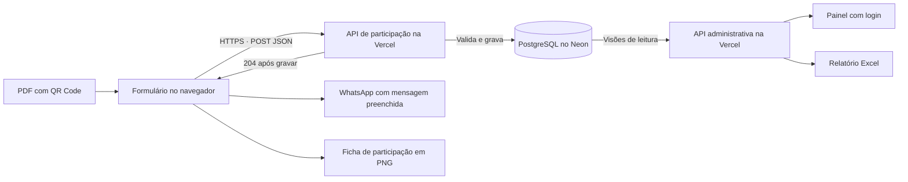
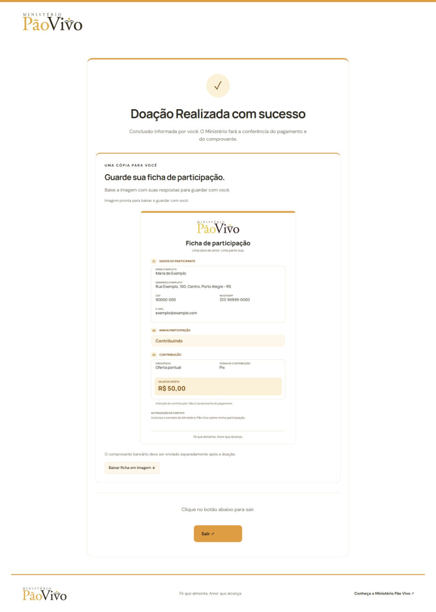

# Sistema de participação e doações | Demonstração acadêmica

Projeto final de **Automação e Programabilidade em Redes** · Wilkerson Magioli

Esta versão usa registros fictícios e simula os pagamentos. Use apenas dados inventados no formulário.

## 1. Sobre o Projeto e Problema Resolvido

O Ministério Pão Vivo mantinha o histórico de doadores em Excel e o formulário era preenchido no papel. O sistema centraliza esse histórico e os novos cadastros em um banco de dados, automatiza o registro de participações e permite consultar e exportar os dados em uma área administrativa protegida por senha.

No formulário público, a pessoa informa a data e escolhe participar orando, contribuindo ou das duas formas. As opções de contribuição são Pix, transferência e boleto.

## 2. Arquitetura e Fluxo de Funcionamento

1. **Gatilho.** O participante abre o formulário pelo QR Code de divulgação e envia os dados.
2. **Processamento.** A API recebe o JSON em `POST /api/participacao`, valida os campos e chama uma função PostgreSQL que registra a participação em uma transação. Repetições com a mesma chave de envio são tratadas sem duplicar a participação.
3. **Saída.** Após a gravação, o fluxo abre o WhatsApp com a mensagem preenchida. O participante confirma o envio no aplicativo e pode baixar a ficha em PNG ao concluir. A etapa de pagamento é simulada.
4. **Consulta.** O painel em `/admin` usa sessão autenticada e visões PostgreSQL de leitura. O administrador pode buscar e filtrar doadores, consultar históricos e exportar o resultado para Excel.

O banco organiza os dados em **Doadores**, **Participações** e **Doações recebidas**. A participação guarda o valor declarado. O pagamento recebido tem um registro próprio, com valor em centavos e situação de conferência. O painel mostra o total de referência das participações e o Excel apresenta os totais nas respectivas abas.

## 3. Tecnologias e APIs Utilizadas

| Camada                | Tecnologias e função                                                                          |
| --------------------- | --------------------------------------------------------------------------------------------- |
| Interface             | HTML, CSS e JavaScript, com Canvas para gerar a ficha em PNG                                  |
| Servidor e publicação | Node.js e funções na Vercel                                                                   |
| Banco de dados        | PostgreSQL no Neon, acessado pelo driver `@neondatabase/serverless`                           |
| Comunicação           | HTTPS entre navegador e API, JSON no cadastro e cookie de sessão para o painel                |
| WhatsApp              | Link `wa.me` com mensagem preenchida para envio pelo participante                             |
| Relatórios            | ExcelJS para exportar arquivos `.xlsx`                                                        |
| Versionamento         | Git e GitHub                                                                                  |

## 4. Pré-requisitos e Como Executar

### Teste rápido para avaliação

A avaliação pode ser feita no navegador com dados fictícios. A [página de acesso por QR Code](https://formulario-mpv-demo.vercel.app/acesso) permite abrir o formulário ou baixar o [PDF da demonstração](public/assets/qr-code-demo.pdf).

1. Abra o [formulário da demo](https://formulario-mpv-demo.vercel.app/) e cadastre uma participação com dados fictícios. Escolher **Orando** permite percorrer o fluxo sem preencher os campos de pagamento.
2. Confira a abertura do WhatsApp de teste com a mensagem preenchida. Você pode conferir a mensagem antes do envio. Volte ao formulário e baixe a ficha em imagem.
3. Abra o [painel da demo](https://formulario-mpv-demo.vercel.app/admin) e use a senha de avaliação `Avaliacao-MPV-2026!`.
4. Busque o cadastro fictício, experimente os filtros e exporte para Excel. Para ver os pagamentos simulados, limpe a busca e exporte novamente.

### Configurar e rodar a demo

1. Em um projeto novo no Neon, execute os arquivos de `banco/migracoes` em ordem numérica. Depois execute [a carga fictícia](banco/dados-ficticios.sql).
2. Crie dois logins no banco de demonstração com senhas distintas. Conceda o papel `mpv_formulario` ao login `mpv_formulario_api` e o papel `mpv_admin_leitura` ao login `mpv_admin_api`.
3. Com Node.js 24, rode `npm ci`. Copie [`.env.example`](.env.example) para `.env` e configure `MPV_DATABASE_URL` com a conexão do primeiro login e `MPV_ADMIN_DATABASE_URL` com a do segundo. Defina `MPV_ADMIN_PASSWORD` com a senha escolhida para essa instalação.
4. Execute `node --env-file=.env server.mjs` e abra `http://127.0.0.1:5173/`. O painel fica em `/admin`.
5. Para publicar, vincule o repositório da demo a um projeto separado na Vercel e configure as mesmas três variáveis com os valores do ambiente de demonstração.

## 5. Demonstração (Resultados)

A carga fictícia inclui duas participações e um pagamento simulado. O cadastro feito no formulário fica disponível para busca no painel. O arquivo exportado tem as abas **Doadores**, **Participações** e **Doações recebidas**.

## 6. Melhorias Futuras (Roadmap)

- Integrar o sistema à API do banco da conta PJ do Ministério Pão Vivo para iniciar o pagamento pelo próprio sistema e acompanhar seu status.
- Integrar a plataforma paga do WhatsApp Business para enviar a ficha de participação em imagem, com o mesmo layout e a identidade visual do projeto.
- Adicionar relatórios por período com a evolução dos valores recebidos e das participações.
